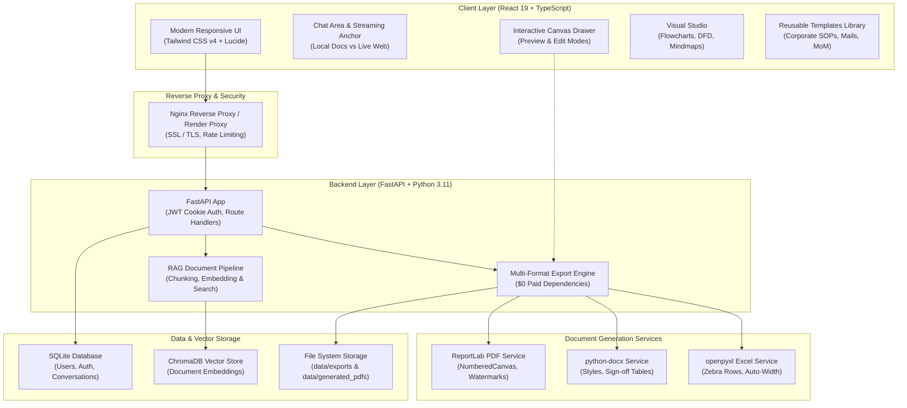
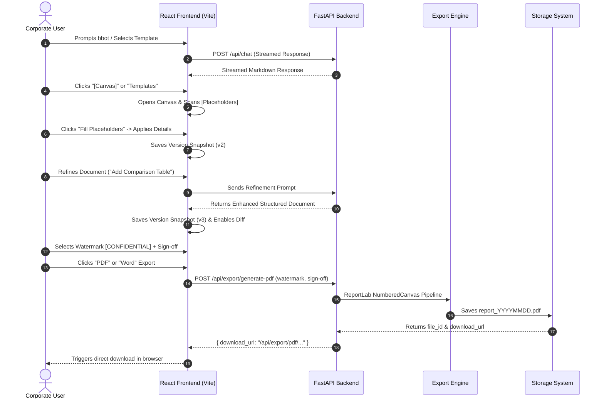
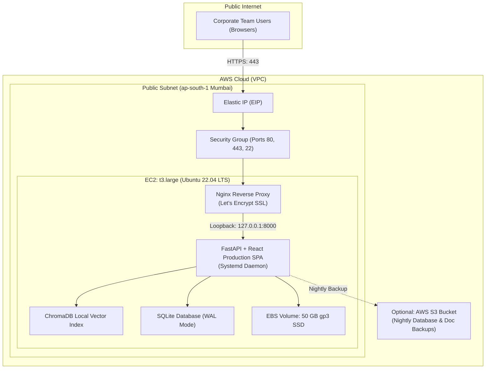

# TRPW bbot • Comprehensive Project Handover & Technical Report

**Document Version:** 1.0.0 (Production Release)  
**Date:** November 18, 2026  
**Project Owner / Organization:** TRPW Strategic Partners  
**Prepared For:** Engineering Leadership & Management  
**Primary Production Repository:** [https://github.com/itinfraanalyst-spec/Bbot.git](https://github.com/itinfraanalyst-spec/Bbot.git) (`main` branch)

---

## 1. Executive Summary

**bbot** is an enterprise-grade AI intelligence and document synthesis platform custom-built for **TRPW Strategic Partners**. The platform bridges real-time document analysis, interactive visual workflow diagramming, structured multi-format document authoring, and presentation-ready corporate exports—all designed with **$0 external paid software dependencies**.

Over the project lifecycle, the platform was taken from an initial RAG proof-of-concept into a production-hardened web application featuring split-screen markdown Canvas editing, smart template variable injection, multi-format ReportLab/docx/openpyxl exports, visual flow diagramming, and automated email dispatching.

---

## 2. High-Level System Architecture & Flowchart



---

## 3. Technology Stack Breakdown

| Layer | Component | Technology / Library | Purpose & Justification |
|---|---|---|---|
| **Frontend Core** | Framework | **React 19, TypeScript, Vite 8** | High-performance SPA with strict typing and rapid HMR. |
| **Styling & Icons** | CSS & UI | **Tailwind CSS v4, Lucide React** | Low-latency utility CSS with zero runtime overhead. |
| **Markdown & Canvas** | Parsing & Sanitization | **ReactMarkdown, RemarkGFM, RehypeSanitize** | Renders tables, lists, and safe HTML without XSS risks. |
| **Visual Diagramming**| Diagrams | **Mermaid.js, HTML-to-Image** | Renders live sequence, flowcharts, and architecture maps. |
| **Backend API** | Web Framework | **Python 3.11, FastAPI, Uvicorn** | Asynchronous, auto-documenting, high-throughput REST API. |
| **PDF Generation** | Export Engine | **ReportLab 4.x** | Two-pass `NumberedCanvas` (Page X of Y), diagonal watermarks ($0 cost). |
| **Spreadsheets** | Export Engine | **openpyxl** | Generates executive `.xlsx` with formatted headers and grid lines ($0 cost). |
| **Word Processing** | Export Engine | **python-docx** | Formatted `.docx` with corporate headers, banners, and RACI tables ($0 cost). |
| **Vector Database** | Embedding Store | **ChromaDB (Local)** | Local on-disk vector database, eliminates Pinecone/cloud DB fees. |
| **Primary Database** | Metadata & Auth | **SQLite 3 (WAL Mode)** | Zero-maintenance, local, ACID-compliant relational storage. |
| **Reverse Proxy** | Web Server | **Nginx + Certbot** | Free auto-renewing Let's Encrypt SSL, rate limiting, gzip compression. |

---

## 4. Complete Inventory of Delivered Features

### A. Document Intelligence & Chat
1. **Dual Knowledge Modes**:
   - **Document (Local)**: 100% private, offline RAG search strictly grounded in uploaded documents (PDF, DOCX, XLSX, CSV, TXT, MD).
   - **Web Search (Live)**: Real-time grounded internet search for live market information and facts.
2. **Multilingual Speech & Script Engine**:
   - Voice Mode with browser Speech-to-Text supporting 10 Indian regional languages + English.
   - Real-time phonetic transliteration script conversion (e.g., typing English phonetics to Hindi script).
3. **Enterprise Rate Limiter**:
   - Multi-tenant rate limiting keyed by JWT authentication cookie and `X-Forwarded-For` proxy headers.

### B. Interactive Canvas & Refinement Studio
1. **Split-Screen & Fullscreen Modes**:
   - Transform any message, SOP, or analysis into a side-by-side editing canvas.
2. **Dual View**:
   - **Preview Mode**: Live styled typography, responsive tables, formatted lists.
   - **Edit Mode**: Raw markdown editor for manual adjustments with instant sync.
3. **Scrollable Refinement Bar**:
   - Smooth `<` and `>` arrow navigation with 8 one-click refinement chips (*Concise, Comparison Table, Missing Steps, Official SOP, Email, Checklist, Summary, Hindi Translation*).
4. **Canvas Version History & Diff Viewer**:
   - Automatic draft snapshots (`v1`, `v2`, `v3`...) on every modification.
   - Version history popover to view timestamps and restore previous drafts in 1 click.
   - Visual Diff mode with line-by-line comparison (<span style="color:green;">+ green added</span>, <span style="color:red;">- red removed</span>).
5. **Smart Template Auto-Fill Wizard**:
   - Automatically detects bracketed placeholders like `[Your Name]`, `[Start Date]`, `[Manager's Name]`.
   - 1-click Smart Pre-Fill modal with batch document replacement.

### C. Reusable Templates Library
- Built-in Enterprise Templates:
  1. *HR Leave / WFH Application*
  2. *Executive SOP Framework (Objective, Scope, RACI Matrix, Escalation)*
  3. *Client Weekly Status & Milestone Update*
  4. *Incident Post-Mortem & Remediation (P1/P2)*
  5. *Meeting Minutes (MoM) & Action Matrix*
  6. *Vendor Request for Quotation (RFQ)*
- Persistent Custom Template creation saved locally in browser storage.
- Direct quick-access button in the **Top Right Header** and Canvas.

### D. Multi-Format Corporate Export Suite ($0 Paid Cost)
1. **Presentation-Grade PDF Export**:
   - Built using ReportLab with dynamic `NumberedCanvas` (exact "Page X of Y" pagination).
   - Dynamic classification watermarks: `CONFIDENTIAL`, `DRAFT`, `INTERNAL ONLY`, `APPROVED`.
   - Header with **TRPW STRATEGIC PARTNERS • bbot Intelligence**.
   - Optional Document Governance & Executive Sign-off Table.
2. **Corporate Excel Export (`.xlsx`)**:
   - Navy header rows, alternating zebra rows, visible gridlines, auto-calculated column widths.
3. **Executive Word Export (`.docx`)**:
   - Section headers/footers, classification top banners, and formatted sign-off tables.

### E. Smart Email Dispatcher
- Replaced unreliable `mailto:` links with an interactive modal:
  - 1-Click Formatted Copy (subject + message).
  - Open in **Gmail Web**.
  - Open in **Outlook Web (Office 365)**.
  - Direct synchronous launch in **Outlook Desktop / Windows Mail App**.

### F. Visual Studio & Cross-Reference Portal
- Integrated node-based visual canvas for flowcharts, mindmaps, and data flow diagrams (DFD).
- Cross-Document Intelligence Portal for comparing disparate files side-by-side.
- State preservation: navigating between Chat, Studio, and Canvas never loses the active conversation.

---

## 5. Document Processing & Canvas Workflow



---

## 6. AWS Infrastructure & Production Deployment Requirements

Because the application is tailored for internal team operations (**1 to 10 concurrent active users**), a bloated, expensive multi-tier cloud setup (ALB + EKS + Multi-AZ RDS) is unnecessary. A single hardened AWS EC2 instance delivers peak performance with near-zero latency and minimal operating cost.

### A. AWS Architecture Diagram (Single-Instance Sizing)



---

### B. Hardware & Instance Sizing Recommendations

#### Option 1: Standard Deployment with External LLM APIs (Recommended)
*Best for: OpenAI (GPT-4o), Anthropic Claude, Azure OpenAI, or AWS Bedrock.*
- **EC2 Instance:** `t3.large` (2 vCPU, 8 GB RAM) or `t3.xlarge` (4 vCPU, 16 GB RAM)
- **Operating System:** Ubuntu 22.04 LTS (x86_64)
- **EBS Storage:** 50 GB General Purpose SSD (`gp3`, 3000 IOPS, 125 MB/s)
- **Network:** AWS Elastic IP (EIP) attached to public subnet
- **Estimated AWS Cost:** **~$35 – $65 / month**

#### Option 2: Air-Gapped / Self-Hosted Local GPU Model
*Best for: Strict on-premise privacy with local GGUF models (e.g. Qwen 2.5 / Llama 3 on CUDA).*
- **EC2 Instance:** `g4dn.xlarge` (4 vCPU, 16 GB RAM, 1x NVIDIA T4 16GB GPU)
- **Operating System:** Ubuntu 22.04 LTS with NVIDIA CUDA 12 drivers
- **EBS Storage:** 100 GB `gp3` SSD
- **Estimated AWS Cost:** **~$160 – $190 / month** (or ~$55/month on AWS Spot Instance)

---

### C. AWS Network & Security Group Configuration

Configure an AWS Security Group named `bbot-production-sg`:

| Rule Type | Protocol | Port Range | Source | Purpose |
|---|---|---|---|---|
| **HTTPS** | TCP | `443` | `0.0.0.0/0` (Anywhere) | Encrypted user traffic to Nginx |
| **HTTP** | TCP | `80` | `0.0.0.0/0` (Anywhere) | Auto-redirect to HTTPS & Let's Encrypt renewal |
| **SSH** | TCP | `22` | `Corporate Office IP / My IP` | Secure administrative server shell access |

> ⚠️ **Security Mandate**: Never open internal port `8000` (FastAPI) to `0.0.0.0/0`. Nginx communicates internally over loopback (`127.0.0.1:8000`), protecting backend APIs from raw public exposure.

---

### D. AWS Step-by-Step Deployment Runbook

#### 1. System Package Setup
```bash
sudo apt update && sudo apt upgrade -y
sudo apt install -y python3-pip python3-venv build-essential git nginx certbot python3-certbot-nginx curl

# Install Node.js 20 LTS
curl -fsSL https://deb.nodesource.com/setup_20.x | sudo -E bash -
sudo apt install -y nodejs
```

#### 2. Code Deployment & Environment
```bash
sudo mkdir -p /opt/chatbot-2
sudo chown -R $USER:$USER /opt/chatbot-2

git clone https://github.com/itinfraanalyst-spec/Bbot.git /opt/chatbot-2
cd /opt/chatbot-2

# Backend virtual environment
python3 -m venv venv
source venv/bin/activate
pip install --upgrade pip
pip install -r requirements.txt

# Frontend build
cd /opt/chatbot-2/client
npm install
npm run build
cd /opt/chatbot-2
```

#### 3. Systemd Service Daemon (`/etc/systemd/system/bbot.service`)
```ini
[Unit]
Description=bbot FastAPI Backend Daemon
After=network.target

[Service]
User=ubuntu
WorkingDirectory=/opt/chatbot-2
ExecStart=/opt/chatbot-2/venv/bin/uvicorn src.main:app --host 127.0.0.1 --port 8000 --workers 2
Restart=always
RestartSec=5
EnvironmentFile=/opt/chatbot-2/.env

[Install]
WantedBy=multi-user.target
```
Enable and start the service:
```bash
sudo systemctl daemon-reload
sudo systemctl enable --now bbot
```

#### 4. Nginx Reverse Proxy & SSL Configuration
Create `/etc/nginx/sites-available/bbot`:
```nginx
server {
    server_name bbot.yourcompany.com;

    client_max_body_size 50M;

    # Serve built React frontend
    location / {
        root /opt/chatbot-2/client/dist;
        try_files $uri $uri/ /index.html;
    }

    # Proxy API & WebSockets to FastAPI backend
    location /api/ {
        proxy_pass http://127.0.0.1:8000;
        proxy_http_version 1.1;
        proxy_set_header Upgrade $http_upgrade;
        proxy_set_header Connection "upgrade";
        proxy_set_header Host $host;
        proxy_set_header X-Real-IP $remote_addr;
        proxy_set_header X-Forwarded-For $proxy_add_x_forwarded_for;
        proxy_set_header X-Forwarded-Proto $scheme;
        proxy_read_timeout 300s;
    }
}
```
Link and activate SSL via free Certbot:
```bash
sudo ln -s /etc/nginx/sites-available/bbot /etc/nginx/sites-enabled/
sudo nginx -t && sudo systemctl reload nginx
sudo certbot --nginx -d bbot.yourcompany.com
```

---

## 7. Strategic Computing Optimizations & Phase 2 Roadmap

To further elevate the platform's cost efficiency, throughput, and business capability, the following high-priority technical initiatives are recommended for subsequent phases:

### A. Computing & Architectural Optimizations (Cost & Latency)
1. **Semantic Response Caching (Redis / SQLite Cache)**:
   - *Design*: Cache LLM responses keyed on semantic embedding similarity (cosine threshold > 0.95).
   - *Impact*: Reduces LLM API token consumption by **40% to 70%** on recurring enterprise queries with near-instant (< 100ms) response times.
2. **Hybrid Search & Neural Reranking**:
   - *Design*: Combine dense vector retrieval (ChromaDB) with sparse keyword retrieval (BM25), followed by a lightweight local cross-encoder (`bge-reranker-small`).
   - *Impact*: Maximizes precision for dense regulatory, legal, and numerical document queries.
3. **Rolling Context Compaction**:
   - *Design*: Implement background rolling summarization for extended chat sessions (e.g. 15+ turns) to prevent context token blowout while maintaining conversational memory.
4. **Backend Concurrency & Process Pooling**:
   - *Design*: Transition Uvicorn to a Gunicorn process pool (`gunicorn -w 2 -k uvicorn.workers.UvicornWorker`) with an asynchronous connection pool for SQLite and ChromaDB.
   - *Impact*: Enhances multi-user concurrent throughput and isolates memory allocations.
5. **Air-Gapped Local Inference (vLLM / AWQ Quantization)**:
   - *Design*: If TRPW mandates 100% on-premise privacy without third-party APIs, deploy 4-bit AWQ quantized open-weights models (e.g. Qwen 2.5 14B / Llama 3.1 8B) on an AWS `g4dn.xlarge` instance using vLLM PagedAttention.

### B. Enterprise Feature Expansion
1. **Cloud Storage Continuous Sync (SharePoint / OneDrive / Google Drive)**:
   - Automated ingestion pipeline syncing corporate repository folders without requiring manual user file uploads.
2. **Side-by-Side Contract Redlining & Diff Analysis**:
   - Multi-document comparison engine that visualizes liability and financial discrepancies in an interactive Canvas redline table.
3. **Interactive Visual Analytics (Plotly / Recharts in Canvas)**:
   - Render interactive bar charts, burn-downs, and financial projections directly from tabular CSV/Excel data within Canvas and export to PDF/DOCX.
4. **Role-Based Access Control & Compartmentalization (RBAC)**:
   - Partition vector database embeddings by departmental access groups (e.g., HR, Finance, Executive, General) to ensure zero data leakage across organizational tiers.
5. **Scheduled Executive Briefing Automations**:
   - Scheduled cron jobs that synthesize weekly status updates every Monday morning and dispatch executive PDF summaries directly via email to leadership.

---

## 8. Project Repositories & Access Credentials

- **Production Git Repository**: [https://github.com/itinfraanalyst-spec/Bbot.git](https://github.com/itinfraanalyst-spec/Bbot.git)
  - Target Branch: `main`
- **Current Live Render Endpoint**: `https://bbot-aq1s.onrender.com`
- **Key Environment Configurations**:
  - `JWT_SECRET_KEY`: Managed in `.env` (256-bit entropy)
  - `DATABASE_URL`: `sqlite:///data/database.db`
  - `CHROMA_PERSIST_DIR`: `data/chroma`
  - `EXPORT_DIR`: `data/exports` and `data/generated_pdfs`

---

## 9. Sign-off & Acknowledgement

This concludes the formal technical handover documentation for **bbot**. The application is verified in a stable production state, all tests and builds pass cleanly (`code 0`), and the infrastructure architecture is fully mapped for seamless deployment to AWS.

*Report compiled by the Engineering Project Lead for TRPW Strategic Partners.*
